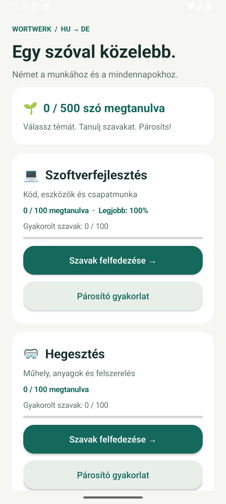
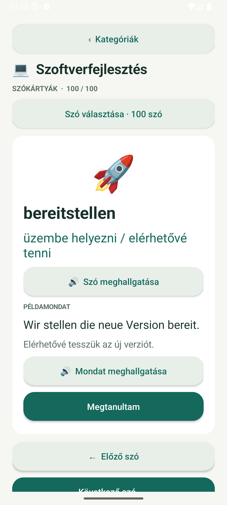
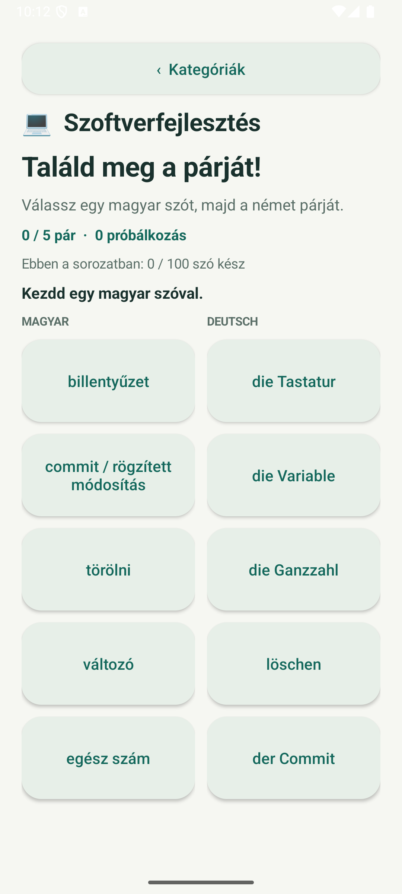
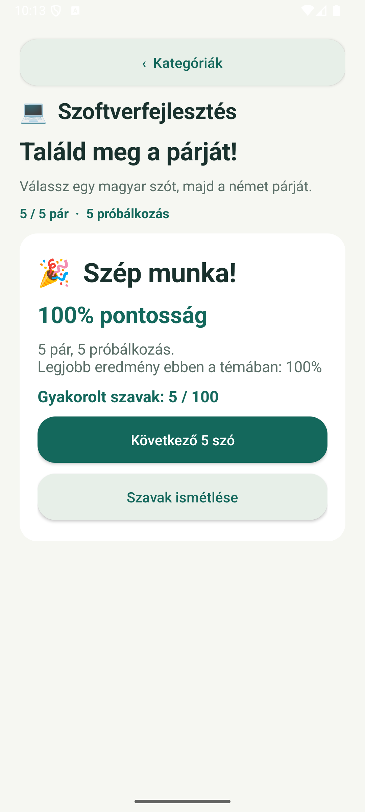

# WortWerk 🇭🇺 → 🇩🇪

**Basic German for Hungarian speakers — at work, in the workshop and around the table.**

WortWerk is a small native Android vocabulary app with illustrated word cards, bilingual example sentences and matching exercises. It is built with Java and Android framework views.

## Screenshots

Real screenshots from WortWerk 1.1.0 running on an Android 16 emulator.

| Pick a category | Learn a word |
| :---: | :---: |
|  |  |
| **Match Hungarian and German** | **See your result** |
|  |  |

## What you can learn

| Category | Hungarian | Words |
| --- | --- | ---: |
| Software engineering | Szoftverfejlesztés | 100 |
| Welding | Hegesztés | 100 |
| Electrical engineering | Elektrotechnika | 100 |
| Cooking | Főzés | 100 |
| Ordering food and drinks | Rendelés | 100 |

Each of the **500 entries** includes an emoji icon, a German word (with its article for nouns), a Hungarian meaning and an example sentence in both languages.

- Listen to German words and sentences through Android text-to-speech.
- Mark words as learned, track progress and jump directly to any card using the word picker.
- Practice all 100 words in each category in 20 five-pair rounds; completed words do not repeat until the category cycle is finished.
- Get immediate feedback, accuracy, a saved personal best and saved practice coverage.
- Continue the current card or exercise after screen rotation.
- Use the vocabulary and exercises offline, without an account.

German pronunciation depends on the phone's TTS engine and installed German voice data. Install an offline German voice if you want offline pronunciation. Learning progress stays on the device; the app has no internet permission or analytics.

## Try it

Requires **Android 8.0 or newer**.

After a successful workflow run, open **Actions → Android CI and preview release → Artifacts → WortWerk-debug**, extract the APK and transfer it to your phone. Open the APK and allow installation from that source if prompted.

With a phone or emulator connected through ADB:

```sh
adb install -r app-debug.apk
adb shell am start -n hu.wortwerk/.MainActivity
```

These are debug builds. APKs signed with different debug keys cannot update one another; uninstalling an older build removes its local progress.

For a short Hungarian user guide, see [Getting started](docs/GETTING_STARTED.md).

## Build locally

Open this folder in Android Studio. Use JDK 17 or newer, Android SDK platform **36.1**, Android build tools **36.0.0**, and the included Gradle wrapper.

**Windows**
```powershell
.\gradlew.bat :app:testDebugUnitTest :app:lintDebug :app:assembleDebug
```

**macOS / Linux**
```sh
bash ./gradlew :app:testDebugUnitTest :app:lintDebug :app:assembleDebug
```

The APK is written to `app/build/outputs/apk/debug/app-debug.apk`. Android Studio can configure `local.properties` with your SDK path. Build dependencies need internet access the first time.

See [Development](docs/DEVELOPMENT.md) for project structure, vocabulary editing, tests and the Windows SDK-only fallback build.

## GitHub CI/CD

The included [workflow](.github/workflows/android.yml) runs on pushes, pull requests and manual dispatch:

1. Verify the Gradle wrapper checksum.
2. Run unit tests and Android lint.
3. Build and upload the debug APK.
4. Upload test and lint reports, including on failed checks.

Every successful push or manual build on the default branch automatically publishes a **GitHub prerelease** with the tested APK and its SHA-256 checksum. Each run gets a unique `preview-RUN_ID-ATTEMPT` tag pointing to the tested commit. Pushing a `v*` tag also publishes a prerelease under that version tag. Pull requests and other branches only run checks; they do not publish. No signing secrets are required. Play Store deployment and production signing are not configured.

The workflow uses pinned Action commits, read-only permissions for checks and write permission only for the prerelease job. Dependabot checks Action updates monthly.

See [GitHub setup and releases](docs/GITHUB.md) for the first push and version-tag workflow.

## Validation

- Twelve vocabulary, matching, complete-category coverage and saved-ID regression tests pass locally.
- The SDK-only debug build and APK signature/alignment checks pass.
- Version 1.1.0 installation, launch and navigation to word 100 were verified on an Android 16 emulator.
- An expanded-pool practice round and saved coverage after app restart were verified on the emulator.
- Screenshots show the 500-word category screen, word 100, matching and a completed round.
- The GitHub workflow has not run yet; it will run after you push.
- Xiaomi 15T Pro hardware, HyperOS-specific behavior, speech and rotation have not been separately verified.

## License

No license has been selected yet. Add a `LICENSE` file before offering the project for reuse.
